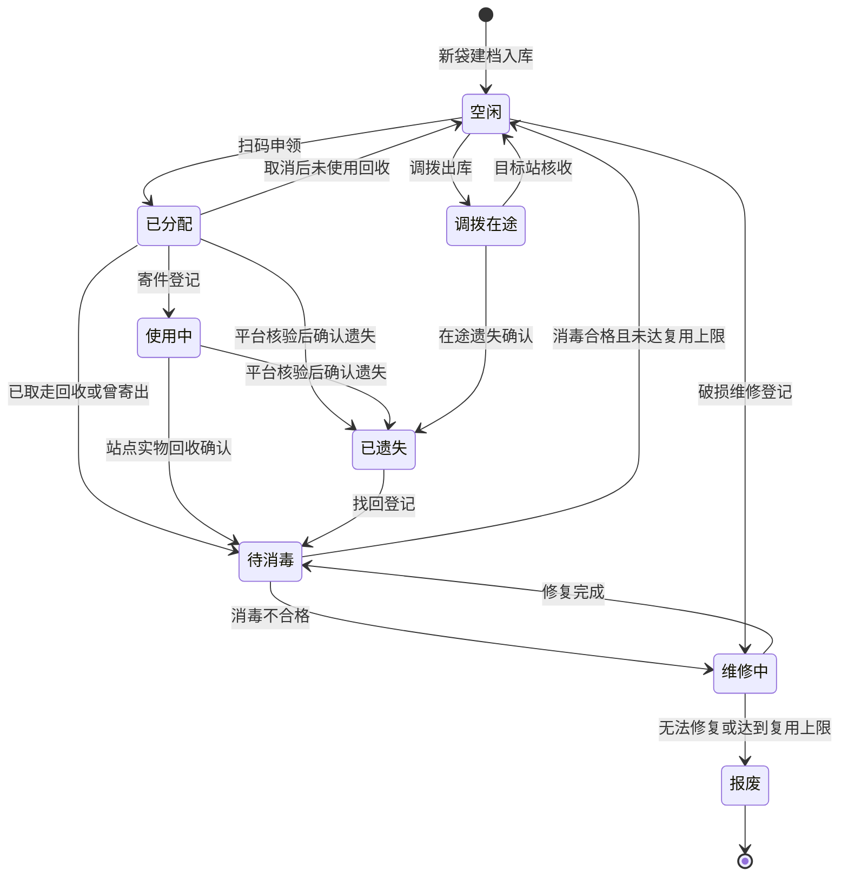
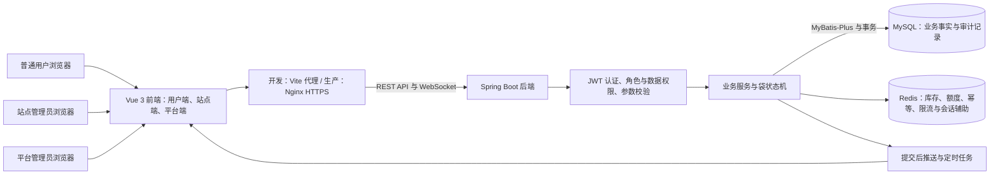

# SEMS（共享快递袋系统）

**Shared Express Mailer System（SEMS）** 是面向校园、社区、写字楼等快递集散场景的共享快递袋循环管理系统。系统以可重复使用的快递袋为载体，将「取、用、还、洗、调」连接成可查询、可追溯、可审计的业务闭环。

本项目为本科毕业设计，采用前后端分离的 B/S 架构，包含普通用户、站点管理员和平台管理员三类使用入口。本仓库保存源代码、数据库脚本、部署配置、测试证据和配套设计文档。

**当前工程版本：v0.1.2。** 当前代码已覆盖主要业务模块；已有测试结论属于阶段验证，完整联调、性能测试、云端部署验证及用户使用手册仍需按计划补齐。

## 目录

1. [项目背景与目标](#1-项目背景与目标)
2. [角色与使用场景](#2-角色与使用场景)
3. [功能模块](#3-功能模块)
4. [业务闭环与状态模型](#4-业务闭环与状态模型)
5. [系统架构与技术栈](#5-系统架构与技术栈)
6. [库存并发与数据一致性](#6-库存并发与数据一致性)
7. [认证权限与安全设计](#7-认证权限与安全设计)
8. [实时推送与后台任务](#8-实时推送与后台任务)
9. [数据模型与统计口径](#9-数据模型与统计口径)
10. [接口与前端交互](#10-接口与前端交互)
11. [仓库结构与文档](#11-仓库结构与文档)
12. [本地启动与完整演示](#12-本地启动与完整演示)
13. [配置构建与部署](#13-配置构建与部署)
14. [测试结果与验证范围](#14-测试结果与验证范围)
15. [常见问题](#15-常见问题)
16. [研发计划与维护约定](#16-研发计划与维护约定)

## 1 项目背景与目标

循环快递包装不仅需要登记袋子数量，还需要知道每只袋在哪里、由谁使用、是否完成回收与消毒，以及何时应当维修、报废或跨站调拨。线下人工管理容易出现库存不透明、重复分配、流转记录缺失和责任难以追溯等问题。

SEMS 将快递袋视为具有唯一身份与生命周期的实体，通过订单、站点、消毒批次、盘点单和调拨单记录各环节的事实，主要目标包括：

- **循环利用**：将申领、寄件、回收和消毒连接起来，区分可用库存与尚未处理的实物。
- **库存可见**：展示站点空闲袋数、状态分布和低库存预警，支持站间调拨。
- **流转可追溯**：每只袋拥有唯一编码、二维码和流转记录，异常处置保留原因及操作人。
- **业务可控**：由后端校验状态、角色、资源归属、用户额度和并发竞争，防止非法流转。
- **运营可分析**：通过看板展示订单趋势、库存分布、站点周转率和异常线索。
- **安全可审计**：围绕身份认证、接口越权、输入校验、敏感数据和操作日志落实安全机制。

系统当前聚焦循环包装资源管理。寄件环节登记快递公司与运单信息，不自动对接物流轨迹；遗失责任登记不执行资金扣费或赔付，也不依赖智能柜等专用硬件。

## 2 角色与使用场景

| 角色                         | 主要使用场景                                                                   | 数据范围                                         |
| ---------------------------- | ------------------------------------------------------------------------------ | ------------------------------------------------ |
| 普通用户`USER`             | 注册登录、扫码取袋、寄件登记、撤回申领、标记归还、查看订单与个人资料           | 本人订单和资料，以及按权限披露的袋信息与站点信息 |
| 站点管理员`STATION_ADMIN`  | 查看本站库存与回收待办，办理回收、实物出库、消毒、维修、报废、盘点及调拨出入库 | 绑定站点及其允许处理的业务资源                   |
| 平台管理员`PLATFORM_ADMIN` | 管理账号与角色、维护站点与袋档案、创建调拨、处理遗失与状态修正、查看统计和审计 | 管理接口范围内的全平台数据                       |

角色权限采用等级门槛，站点和本人数据权限仍由业务服务单独校验。高等级角色不意味着可以绕过所有资源归属检查，例如本人订单接口和用户订单推送仍限制对应用户。

自助注册只能创建普通用户；站点管理员由平台管理员创建或授权，并绑定站点。初始或重置口令会触发强制改密，改密前限制业务操作。

前端入口按角色组织：用户端为 `/m/**`，站点端为 `/station/**`，平台端为 `/platform/**`。用户端优先适配手机，管理端提供工作台、台账、表格和统计视图，并使用共享的状态标签、分页、时间线和批量结果组件。

## 3 功能模块

系统按六个业务模块组织，模块之间通过快递袋状态流转和业务单据关联。

| 模块              | 主要能力                                                                           | 业务价值                     |
| ----------------- | ---------------------------------------------------------------------------------- | ---------------------------- |
| M1 用户管理       | 图形验证码、注册登录、个人资料、改密、账号创建、角色授予、站点绑定、启停及密码重置 | 管理身份、角色和站点职责     |
| M2 共享快递袋服务 | 扫码查袋、申领、寄件登记、撤回申领、归还引导                                       | 为用户提供取用和归还入口     |
| M3 共享站点管理   | 站点档案、启停、库存、预警、回收箱待办、回收确认、站间调拨                         | 管理站点收发和资源分配       |
| M4 快递袋管理     | 单袋及批量建档、二维码、台账、追溯、消毒、维修、报废、找回、盘点和状态修正         | 管理每只袋的生命周期         |
| M5 快递订单管理   | 本人及管理端查询、归还标记、取消与超时记录、遗失确认和责任登记                     | 记录用户取用至实物回收的过程 |
| M6 后台与统计     | 平台看板、订单趋势、库存分布、站点周转率、异常告警、操作审计和登录日志             | 支持运营判断与安全追溯       |

### 用户端

用户可以查看启用站点及可用库存，通过摄像头扫码或手动输入袋码查询袋信息，确认申领后登记寄件信息。订单列表和详情展示业务进度；归还时选择站点并标记投放，后续由站点确认实物回收。个人中心支持资料维护、改密和退出登录。

### 站点端

站点工作台汇总库存、预警和回收待办。管理员按实物扫码建立处理清单，办理回收、消毒、实物出库、维修报废及调拨核收。批量业务展示成功数、失败数与逐袋原因，便于处理部分失败。

### 平台端

平台管理员维护全平台账号、站点和袋台账，批量生成袋码及二维码，跟踪调拨与订单，核验异常后确认遗失或修正状态。统计看板使用 ECharts 展示订单趋势、库存分布与站点周转率；审计页面用于追查关键操作与越权尝试。

## 4 业务闭环与状态模型

### 4.1 快递袋生命周期

正常循环为 **空闲 → 已分配 → 使用中 → 待消毒 → 空闲**，另保留维修中、报废、已遗失和调拨在途四个扩展状态。



本图展示主流程；直接报废、同态归还标记和管理员状态修正等完整规则以 [系统设计说明书](文档/系统设计说明书.md) 第 3 章及后端 `TransitionRegistry` 为准。

| 状态码           | 含义                                                   | 是否计入可用库存 |
| ---------------- | ------------------------------------------------------ | ---------------- |
| `IDLE`         | 空闲，可进入申领流程；仍需检查调拨锁等条件             | 是               |
| `ALLOCATED`    | 已分配，尚未登记寄件，实物仍由用户或站点管理           | 否               |
| `IN_USE`       | 已登记寄件，处于使用环节；用户标记归还时袋仍保持此状态 | 否               |
| `TO_DISINFECT` | 已回收，等待消毒处理                                   | 否               |
| `TRANSFERRING` | 站点间调拨运输中                                       | 否               |
| `REPAIRING`    | 正在维修                                               | 否               |
| `LOST`         | 已经人工核验并确认遗失，可在找回后重新进入消毒流程     | 否               |
| `SCRAPPED`     | 已报废，退出循环，是唯一终态                           | 否               |

### 4.2 取袋、寄件与取消

1. 用户扫码或输入 `SJB-` 袋码，查询袋状态与所在站点。
2. 申领时校验袋可用、未被活动调拨锁定、用户在持额度和日申领频次。
3. Redis 原子预扣库存与额度；后端在数据库事务中推进袋状态并创建待寄件订单。
4. 用户提交快递公司、运单号与收件手机号，袋及订单进入使用环节。
5. 用户可以撤回尚未寄件的申领；未在规定时间内寄件的订单也会被取消。

**撤回或超时取消只改变订单，不代表实物已经回收。** 袋仍可能保持 `ALLOCATED`，在持额度不会因此释放；需由站点确认收回实物后再处理库存和额度。

### 4.3 归还、回收与消毒

用户选择归还站点并标记投放后，订单进入待回收确认。此时袋仍为使用中，所属站点和可用库存均不立即改变。

站点管理员按实物扫码确认回收，系统校验订单与袋状态，并记录确认站点。已使用袋进入待消毒区，完成对应订单闭环并更新在持额度；实际使用后的回收路径会增加复用次数。消毒登记记录批次、方式、逐袋判定与缺陷说明：合格且未达复用上限的袋自动回到空闲并入库，不合格的袋进入维修流程。

系统支持跨站回收和用户未标记归还的直接投放。平台代操作、跨站回收及未标记直投留存相应审计信息。已取消订单对应的未使用袋可按未使用回收路径直接恢复空闲；若实物曾寄出，应按实际情况标注并进入消毒流程。

### 4.4 调拨、维修与遗失

- **调拨**：平台登记源站、目标站与袋清单，整单校验空闲状态、源站归属和活动调拨引用。建单后袋被调拨引用锁定；源站出库后进入 `TRANSFERRING`，目标站核收后变为空闲并转移归属。建单锁定与实物出库是不同节点。
- **维修**：登记破损描述；修复完成后仍须消毒，不能直接恢复可用库存。无法修复或达到复用上限时登记报废。
- **遗失**：达到相应时间窗口后，由平台人工核验并确认，记录责任主体、结论与备注；超时提醒不会自动裁定遗失。
- **找回**：登记找回原因及站点，保留原责任结论并追加注记，袋进入待消毒流程。

### 4.5 盘点与状态修正

盘点账面数由数据库按袋状态实时统计，实盘数由管理员根据现场清点填写。无差异盘点可直接关闭；有差异时生成供人工核验的袋级候选，保留待处理状态，也支持填写原因后作废重盘。

状态修正仅供平台管理员使用：原因 `remark` 必填，目标态限于 `IDLE`、`REPAIRING`、`LOST`、`SCRAPPED`，跨站修正可指定 `targetStationId`。修正仍须通过状态、调拨锁及事务校验，不能修改已报废终态。

**盘点候选不是实物结论，状态修正不会自动关联或关闭盘点单。** 自 v0.1.1 起，状态修正入参不包含 `refCheckNo`；历史流转记录中的兼容字段继续保留。

### 4.6 订单与袋状态的区别

| 订单状态            | 含义       | 袋状态或业务关系                                   |
| ------------------- | ---------- | -------------------------------------------------- |
| `PENDING_SEND`    | 待寄件     | 袋通常为已分配                                     |
| `IN_USE`          | 使用中     | 已登记寄件，袋为使用中                             |
| `PENDING_CONFIRM` | 待回收确认 | 已标记归还，袋仍为使用中                           |
| `FINISHED`        | 已完成     | 对应使用订单已完成回收，袋可继续消毒和下一轮循环   |
| `CANCELLED`       | 已取消     | 订单取消不等于袋已回收，要结合实物和袋当前状态判断 |
| `LOST`            | 已遗失     | 已完成对应遗失确认与责任登记                       |

订单记录一次取用过程，袋档案记录当前实物状态；同一袋可以有多次历史订单。超时通过标记字段与异常线索表达，不是额外的订单状态。

## 5 系统架构与技术栈

### 5.1 总体架构



前端负责页面渲染、表单交互与接口调用；后端负责业务校验、授权、状态流转和持久化。MySQL 是业务事实与库存状态的权威来源，Redis 提供快速计数和控制机制；WebSocket 推送帮助页面及时刷新，但断线恢复后仍需重新查询当前数据。

### 5.2 技术组成

| 层次         | 技术                                                     | 在系统中的职责                                     |
| ------------ | -------------------------------------------------------- | -------------------------------------------------- |
| 后端运行环境 | JDK 21、Spring Boot 3.5.x                                | 应用启动、REST 接口、配置、事务与任务调度          |
| 持久化       | MyBatis-Plus、MySQL 8.0                                  | 实体映射、分页、业务查询、条件更新与数据存储       |
| 缓存与控制   | Redis 7、Lua                                             | 库存与额度预扣、幂等、限流、验证码、会话辅助与对账 |
| 认证与密码   | JJWT 0.13.x、BCrypt                                      | JWT 签发验证与密码摘要                             |
| 前端基础     | Vue 3、Vite 8、Vue Router                                | 页面、构建、角色路由及开发代理                     |
| 界面与状态   | Element Plus、Pinia、Axios                               | 管理界面、会话状态与统一请求处理                   |
| 图表与扫码   | ECharts 6、ZXing、BarcodeDetector / jsQR                 | 统计图表、后端二维码生成和前端识别                 |
| 接口与质量   | springdoc-openapi、JUnit、JaCoCo、OWASP Dependency-Check | 接口文档、测试、覆盖率和显式依赖扫描               |
| 运行与部署   | Docker Compose、Nginx                                    | 本地 MySQL / Redis，生产静态托管和反向代理         |

版本以 [后端 POM](<Shared Express Mailer System/backend/pom.xml>)、[前端 package.json](<Shared Express Mailer System/frontend/package.json>) 及锁文件为准；技术选型与版本基线见设计书第 2 章。项目使用 Spring Boot 3.5.x，不采用 Spring Boot 4.x。

### 5.3 工程分层

后端根包为 `com.sems`，Maven 坐标为 `com.sems:sems-backend`。接口层接收请求，业务服务执行授权与业务编排，状态机统一处理既有袋的合法流转，Mapper 访问数据库；公共基础模块提供统一响应、异常、Redis 服务、审计、认证和实时推送。

前端工程名为 `sems-frontend`，按 `api`、`stores`、`router`、`layouts`、`components`、`views` 和 `utils` 分工。颜色和状态视觉规则由设计令牌集中管理；扫码输入、袋流转时间线、状态标签、分页和批量结果弹窗复用公共组件。

## 6 库存并发与数据一致性

### 6.1 原子预扣与数据库校验

申领库存流程同时处理库存量、在持额度和日申领次数，避免分别检查造成竞争窗口：

1. Lua 检查站点库存是否完成初始化、是否正在对账，以及用户额度与日频次是否超限。
2. 所有检查通过后，在同一脚本中扣库存、写带过期时间的预扣凭据、增加在持数和日计数。
3. 后端通过袋行锁和带前态、版本号条件的更新，验证该袋是否仍能分配。
4. 袋变更、流转日志和伴随订单事实在同一数据库事务内提交。
5. 幂等完成缓存和业务推送在数据库提交后处理，避免把回滚结果当成成功。

Lua 原子性覆盖 Redis 内部操作，不等于 Redis 与 MySQL 构成一个分布式事务；两者之间通过凭据、补偿和对账处理失败。

### 6.2 补偿、熔断与对账

数据库落单失败时，同步补偿以预扣凭据作为防重复门闩，避免同一失败重复增加库存。在用户撤回或未寄件超时取消时，则保留实物待回收的事实，不直接回库或释放在持额度。

系统还包含库存初始化互斥与持有者校验、库存定期对账、在持数重建和 Redis 故障熔断恢复。Redis 不可用时，部分业务按现有策略使用数据库校验或查询回退；故障恢复后重建相关计数。孤儿预扣清理、补偿和数据库对账各有职责，不能把凭据过期理解为自动实物归还。

### 6.3 幂等与批量操作

认证后的写接口使用 UUID 形式的 `clientRequestId`。正常完成的响应在幂等窗口内可回放；处理中占位避免同一请求并发执行，回滚时清理占位。前端重试库存初始化或对账中的请求时复用原请求 ID。

逐袋执行的回收、消毒、出库和调拨动作允许部分成功，结果使用 `total`、`success`、`failed`、`items` 统一信封。创建调拨清单等整单校验操作与逐袋动作的事务边界不同，不能只凭 HTTP 成功判断所有袋均已处理。

## 7 认证权限与安全设计

安全机制是本项目网络空间安全专业方向的重点，覆盖认证、授权、输入、数据和审计等层面。

| 安全领域   | 当前机制                                                                                     |
| ---------- | -------------------------------------------------------------------------------------------- |
| 身份认证   | HS256 JWT，校验签名、有效期与必要声明，拒绝非预期算法；密钥缺失或不足 32 字节时启动失败      |
| 会话与账号 | `jti` 黑名单、账号 `token_version`、启停状态与强制改密检查；支持旧密钥只验不签的轮换窗口 |
| 密码保护   | BCrypt 摘要存储，登录失败锁定，图形验证码一次消费；重置后强制改密                            |
| 垂直越权   | `@RequireRole` 及角色等级拦截，校验接口访问门槛                                            |
| 水平越权   | Service 校验本人订单、本站资源和调拨操作站点，前端菜单与路由不替代后端授权                   |
| 输入与注入 | DTO 参数校验、袋码及运单格式校验、状态与排序字段白名单、MyBatis 参数绑定                     |
| 敏感数据   | 收件手机号保存掩码与带版本 HMAC；普通账号信息和审计列表按出参策略脱敏                        |
| 操作审计   | 登录结果、关键业务动作、越权与状态拒绝等事件留痕；参数脱敏，审计写入失败有降级处理           |
| 请求保护   | Redis 限流、业务额度、幂等控制；Nginx 示例提供登录、申领与扫码三类 IP 限流                   |
| 生产边界   | 显式生产 profile、环境变量凭据、生产关闭 OpenAPI 暴露，Nginx 示例提供 HTTPS 与安全响应头     |

手机号处理按用途区分：收件人号码明文不落订单库；账号手机号用于登录，在用户表中保存原值，普通出参脱敏，平台用户管理按权限查看完整信息。审计 IP 原值保留用于追溯，列表展示掩码，完整 IP 查询提供逐条受控接口并记录查看行为。

故障策略存在明确边界：Redis 黑名单检查异常时设备级吊销可降级放行；账号快照异常可回退数据库。敏感账号变更提交后会清理缓存，但缓存删除失败可能使旧快照存活至 60 秒 TTL。不能将这些机制描述为任何故障条件下都立即吊销。

开发配置中有公开的演示口令与开发密钥，只用于本地环境。生产必须设置独立随机密钥与账号凭据，验证数据库最小授权、可信代理与审计链，并按测试计划完成安全验证。

## 8 实时推送与后台任务

### 8.1 WebSocket

后端使用原生 WebSocket 端点 `/ws`。连接建立后须在 10 秒内发送首帧认证；JWT 放在消息帧中，不放在 URL 查询参数中。认证后按主题订阅，服务端校验角色和主题归属。

| 主题                     | 推送内容         | 订阅范围               |
| ------------------------ | ---------------- | ---------------------- |
| `user/{uid}/order`     | 用户订单变化     | 对应普通用户本人       |
| `station/{id}/stock`   | 站点库存变化     | 本站管理员或平台管理员 |
| `station/{id}/recycle` | 站点回收待办变化 | 本站管理员或平台管理员 |
| `platform/dashboard`   | 平台看板异动通知 | 平台管理员             |

会话管理包含心跳、首帧超时、账号与令牌状态复查。前端使用退避重连，并在回到前台时尝试恢复连接和重新查询数据。推送在业务事务提交后发送；断线期间没有完整事件补发机制，接口查询仍是恢复当前页面状态的依据。

### 8.2 自动处理与人工裁决

| 任务                 | 职责                                                                 |
| -------------------- | -------------------------------------------------------------------- |
| 启动恢复             | 清理无对应订单的孤儿预扣凭据，初始化启用站点库存                     |
| 未寄件与使用超时扫描 | 取消超时未寄件订单，生成或推送寄件后未归还提醒，记录取消后未回收异常 |
| 回收与调拨超时扫描   | 提醒长时间未确认回收的站点，并记录回收、调拨超时线索                 |
| 库存对账             | 将站点 Redis 可用库存与稳定的数据库空闲袋计数核对                    |
| 在持额度对账         | 按实际持袋关系纠正用户在持计数                                       |
| 日统计汇总           | 生成站点与全平台的每日订单、库存和周转率快照                         |

超时扫描主要提供提醒和异常线索。遗失裁决、状态修正、盘点核验及实物回收仍需相应管理员操作。

## 9 数据模型与统计口径

### 9.1 业务数据

初始化 DDL 包含 **21 张业务表**，按职责分组如下：

| 数据组     | 表                                                                              | 保存的事实                           |
| ---------- | ------------------------------------------------------------------------------- | ------------------------------------ |
| 身份权限   | `sys_user`、`sys_role`、`sys_user_role`                                   | 账号、固定角色、授权关联             |
| 站点与实物 | `station`、`bag`、`stock_record`、`bag_transfer_log`                    | 站点、袋档案、实物流水和生命周期追溯 |
| 订单与责任 | `bag_order`、`liability_record`、`stock_compensation_log`                 | 取用订单、异常责任和库存补偿凭证     |
| 消毒与处置 | `disinfect_record`、`disinfect_detail`、`repair_record`、`scrap_record` | 消毒批次及明细、维修、报废           |
| 盘点与调拨 | `inventory_check`、`allocation_order`、`allocation_detail`                | 账实快照、调拨单头及逐袋进度         |
| 安全与统计 | `audit_log`、`login_log`、`stats_daily`、`sys_metric`                   | 审计、登录事件、日汇总和运行指标     |

数据库通过唯一索引、条件更新、事务及服务校验保证业务完整性，当前不使用物理外键和逻辑删除。审计与流转记录在应用业务中按追加方式留存；归档清理由运维职责处理。

Redis 保存库存计数、预扣凭据、用户额度、验证码、认证快照、幂等、限流和风险计数等控制数据。其键空间、TTL 与回退规则见 [数据库设计说明书](文档/数据库设计说明书.md) 第 6 章。

### 9.2 袋码与二维码

袋码格式为 `SJB-<规格>-<年月>-<五位流水>-<校验位>`，后端负责生成与校验，数据库唯一键兜底。`SJB-` 是实物袋码前缀，与 `com.sems` 包名或工程名称无关。

单袋二维码生成 PNG；批量建档可下载包含二维码和清单的 ZIP。二维码内容由配置的访问域名生成，旧标签不会随配置改变而自动更新。前端识别优先使用 BarcodeDetector，不支持时使用 jsQR；摄像头通常需要 HTTPS 或本机 localhost 的安全上下文，也提供手动输入袋码入口。

### 9.3 看板与异常线索

看板提供在用袋数、在循环袋数、今日取还、库存分布、预警及运行指标，配合订单趋势和站点周转率图表。异常清单覆盖取消后未回收、回收超时、调拨超时、寄件后未归还、审计丢弃、库存对账差异和高频确认等线索。

统计需要遵循具体口径：可用库存按站点 `IDLE` 数量统计；当前周转率实现使用当前在循环袋数近似周期分母，并非历史实测平均库存。告警由业务数据与指标实时组装，每个来源有扫描上限，不是无限量事件仓库。

## 10 接口与前端交互

### 10.1 接口分组

业务 REST 接口统一使用 `/api/v1` 前缀，按资源分组；健康检查位于 `/api/health`，WebSocket 位于 `/ws`。

| 接口组     | 代表路径                                                                                    | 用途                                   |
| ---------- | ------------------------------------------------------------------------------------------- | -------------------------------------- |
| 认证       | `/auth/captcha`、`/auth/register`、`/auth/login`、`/auth/refresh`、`/auth/logout` | 验证码、注册登录、续签与退出           |
| 用户       | `/users`、`/users/me`                                                                   | 个人资料和平台账号管理                 |
| 取用       | `/borrows`、`/borrows/{orderNo}/shipping`                                               | 申领、寄件与撤回动作                   |
| 订单       | `/orders`、`/orders/mine`、`/orders/{orderNo}/return-mark`                            | 管理查询、本人订单、归还标记与遗失确认 |
| 快递袋     | `/bags`、`/bags/{bagCode}/info`、`/bags/{bagCode}/trace`                              | 建档、查询、二维码、追溯与处置         |
| 站点       | `/stations`、`/stations/{id}/stock`、`/stations/{id}/recycle-confirm`                 | 站点维护、库存与回收确认               |
| 消毒与盘点 | `/disinfections`、`/inventory-checks`                                                   | 批次、盘点提交、查询和作废             |
| 调拨       | `/allocations`、`/allocations/{id}/dispatch`、`/allocations/{id}/receive`             | 建单、出库、核收及异常处置             |
| 统计与告警 | `/stats/dashboard`、`/stats/order-trend`、`/alerts`                                   | 看板、趋势和异常线索                   |
| 审计       | `/audit-logs`、`/login-logs`                                                            | 平台审计查询及逐条完整 IP 查看         |

表中路径相对于 `/api/v1`。具体方法、参数、权限、响应和错误码以设计书第 5、6 章及后端 Controller 为准。

### 10.2 响应与错误处理

普通接口使用统一 JSON 信封：

```json
{
  "code": 0,
  "message": "success",
  "data": {}
}
```

`code=0` 表示成功；分页结果位于 `data.records`、`data.total`、`data.pages`。逐袋批量结果使用 `data.total`、`data.success`、`data.failed` 和 `data.items`；二维码 PNG 与批量 ZIP 使用二进制响应。

未认证、无权限、参数错误、系统异常及库存暂不可用等情况映射为相应 HTTP 状态。其余部分业务拒绝仍可能返回 HTTP 200，因此客户端必须同时读取业务 `code`，不能只检查 HTTP 状态。

认证请求使用 `Authorization: Bearer <JWT>`；认证后的写请求按契约附带 `clientRequestId`。匿名登录与注册不使用接口级幂等，由验证码、登录锁定等机制处理。开发环境可访问 `http://localhost:8090/swagger-ui.html` 和 `/v3/api-docs`；生产配置关闭这些接口文档入口。

### 10.3 前端体验与职责

前端通过 Axios 统一注入认证和幂等头、解析响应、处理 401 跳转及库存可重试错误；Pinia 管理会话，令牌以内存为主、sessionStorage 为标签页级恢复手段。页面路由根据登录态、角色和强制改密状态控制导航。

扫码识别、表单校验、状态标签与批量明细用于提升交互效率。前端校验不替代后端校验，页面显示的库存、角色和袋状态也不作为提交操作的最终授权依据。

## 11 仓库结构与文档

```text
SEMS/
  README.md                       项目总览与启动入口
  AGENTS.md                       项目范围、技术栈和维护规则
  Shared Express Mailer System/
    README.md                     工程环境与本地辅助说明
    backend/                      后端、Maven Wrapper、单元测试
    frontend/                     前端代码、配置和依赖锁文件
    deploy/
      docker/                     本地 MySQL 与 Redis
      sql/                        建表、种子和升级脚本
      nginx/                      生产反向代理示例
    scripts/                      环境管理与开发辅助工具
    docs/releases/                版本发布记录
  文档/
    需求规格说明书.md
    系统设计说明书.md
    数据库设计说明书.md
    测试报告.md
    任务书/                       任务书文本及本地原件
    测试附件/                     机器可读测试证据
    归档/                         历史过程稿与审查记录
  aoci.txt                        仓库认知根索引
  aoci.meta.txt                   认知规则与标签字典
  aoci.code.txt                   文件认知条目
  aoci.database.txt               数据库对象认知条目
  .aoci/                          正式治理配置与基线
```

| 文档                                                                     | 用途                                               |
| ------------------------------------------------------------------------ | -------------------------------------------------- |
| [任务书文本](文档/任务书/_extracted.txt)                                  | 项目范围、固定技术栈、硬性交付物及时间要求         |
| [需求规格说明书](文档/需求规格说明书.md)                                  | 功能需求、角色用例、业务规则、非功能要求与验收追溯 |
| [系统设计说明书](文档/系统设计说明书.md)                                  | 架构、状态机、接口、安全、前端及部署方案           |
| [数据库设计说明书](文档/数据库设计说明书.md)                              | 21 表字段、索引、Redis 键空间、数据安全与初始化    |
| [测试报告](文档/测试报告.md)                                              | v0.1.1 阶段测试方法、结果与未覆盖事项（历史快照）   |
| [测试附件](文档/测试附件/v0.1.1/)                                         | 覆盖率摘要及接口、并发回归结果（对应 v0.1.1）       |
| [v0.1.2 发布说明](<Shared Express Mailer System/docs/releases/v0.1.2.md>) | 本次前端视觉升级的变化、兼容性与验证               |
| [v0.1.1 发布说明](<Shared Express Mailer System/docs/releases/v0.1.1.md>) | 四态循环与并发防护的历史版本说明                   |

用户使用手册尚待补齐。本地 `正式提交/` 是只读材料目录，目前没有纳入 Git；归档文档反映对应历史阶段，不代表当前缺陷状态。依赖、构建产物、本机配置、运行日志、临时证据和真实凭据由忽略规则排除。

## 12 本地启动与完整演示

### 12.1 环境要求

| 工具          | 要求与说明                                                       |
| ------------- | ---------------------------------------------------------------- |
| JDK           | 21；构建和运行使用`JAVA_HOME`，不依赖 PATH 中可能存在的 Java 8 |
| Node.js       | `^20.19.0` 或 `>=22.12.0`，与前端 `engines` 一致           |
| PowerShell    | Windows 上使用 PowerShell 7（`pwsh`）                          |
| Docker        | Docker Desktop 与 Compose，先启动容器引擎                        |
| Maven         | 使用仓库内 Maven Wrapper，无需另装 Maven                         |
| MySQL / Redis | 本地使用 Compose 容器，不另建一套 Windows 数据库工具链           |

以下各启动终端均从**仓库根目录**开始。已有环境优先使用现成工具，首次运行需下载 Maven、npm 依赖与容器镜像。

### 12.2 启动数据库与 Redis

先打开 Docker Desktop，再执行：

```powershell
Set-Location 'Shared Express Mailer System'
.\scripts\db-up.cmd
docker compose -f .\deploy\docker\docker-compose.yml ps
```

默认容器为 `sems-mysql` 和 `sems-redis`，端口为 `3306` 和 `6379`。请确认容器已健康后再启动后端；数据通过命名卷持久化。

首次空数据卷会按顺序执行 `V1__init_schema.sql`、`V2__init_data.sql`、`V3__simplify_bag_status.sql`。种子数据包含三类角色、两个示例站点和一个预置平台管理员，**不自动创建其他演示用户或可申领快递袋**。

可选本地配置位于 `deploy/docker/.env.example`，复制为同目录 `.env` 后按需调整；`.env` 不入库。Compose 的 `.env` 不会自动传入后端进程，修改口令、数据库名或端口时需同步后端连接配置。

### 12.3 启动后端

另开终端，确认 JDK 并运行 Maven Wrapper：

```powershell
& "$env:JAVA_HOME/bin/java.exe" -version
Set-Location 'Shared Express Mailer System/backend'
.\mvnw.cmd spring-boot:run
```

Windows 必须使用 `mvnw.cmd`，不能将无扩展名的 POSIX `mvnw` 当作 PowerShell 命令。Wrapper 的 Maven 发行包地址使用阿里云；依赖镜像取决于本机 Maven 配置，仓库不会替其他机器自动配置全局镜像。

`spring-boot:run` 由 POM 默认激活开发 profile，默认端口为 `8090`。存活检查可以在另一终端执行：

```powershell
Invoke-RestMethod 'http://localhost:8090/api/health'
```

健康端点只提供存活状态，不表示数据库、Redis 或全部业务均已通过验证。

### 12.4 启动前端

另开终端：

```powershell
Set-Location 'Shared Express Mailer System/frontend'
npm ci
npm run dev
```

前端默认地址为 `http://localhost:5173`，实际端口以终端输出为准；Vite 将 `/api` 和 `/ws` 代理到后端 `8090`。前端使用工程级 `.npmrc`，不改变本机全局 npm 源。

### 12.5 首次登录与演示路线

全新环境的平台管理员手机号为 `13800000000`，初始口令为 `Sems@2026`，首次登录必须改密。上述值只用于本地演示。原工程 README 中另外三个演示账号来自已有本机联调数据，新克隆后不能假定这些账号存在。

建议按以下顺序演示完整闭环：

1. 平台管理员登录并改密，检查示例站点，创建并绑定站点管理员。
2. 创建普通用户或通过注册入口注册，准备后续取袋账号。
3. 平台管理员为站点创建快递袋或批量建档，查看并下载二维码。
4. 普通用户扫码或输入袋码申领，登记寄件信息，查看订单变化。
5. 用户选择站点标记归还，站点管理员按实物扫码确认回收。
6. 站点管理员登记合格消毒，查看袋回到空闲及库存恢复。
7. 展示流转追溯、统计与审计；另用测试袋演示维修、盘点或跨站调拨。

只有现场实物已收回时才执行回收确认；演示取消、遗失和报废等分支应使用独立测试数据。

### 12.6 关闭与辅助工具

前后端前台终端用 Ctrl+C 停止。工程目录下的脚本职责如下：

| 脚本                              | 用途与边界                                                                               |
| --------------------------------- | ---------------------------------------------------------------------------------------- |
| `scripts/db-up.cmd`             | 检查环境和端口后启动中间件                                                               |
| `scripts/db-down.cmd`           | 停止中间件，保留数据卷                                                                   |
| `scripts/db-reset.cmd`          | 确认后删除本地 MySQL / Redis 数据卷并重建，会丢失现有数据                                |
| `scripts/check-env.cmd`         | 查看 Java、Node、Git 和 Docker 环境                                                      |
| `scripts/db-navicat-compat.ps1` | 为本地 Navicat 12 切换 MySQL 账号认证插件，保留业务表与权限，但按容器配置设置账号口令    |
| `scripts/remote-access.mjs`     | 临时 HTTPS 手机入口，随机独立口令，四小时后自动停止，需要现有 cloudflared 和前端构建产物 |

手机远程演示的启动与关闭步骤见 [临时手机访问说明](<Shared Express Mailer System/scripts/远程手机访问说明.md>)。该入口提供静态前端及限定 API / WebSocket 转发，是开发演示工具，不是生产部署方案。

## 13 配置构建与部署

### 13.1 环境配置与业务参数

| 配置文件                            | 职责                                            |
| ----------------------------------- | ----------------------------------------------- |
| `application.yml`                 | 公共配置、连接池、序列化及业务参数              |
| `application-dev.yml`             | 开发端口、容器连接、开发密钥与接口文档          |
| `application-prod.yml`            | 生产环境变量凭据，关闭 OpenAPI 与 Swagger UI    |
| `deploy/docker/.env`              | 仅本地 Compose 使用的机器配置，不入库           |
| `frontend/vite.config.js`         | 开发代理、别名与构建分包                        |
| `deploy/nginx/nginx.conf.example` | 生产域名、TLS、静态托管、反代、响应头与限流示例 |

主要默认业务参数如下；不同时间窗口的触发条件和是否可配置，以设计书第 3.5 节和实现为准。

| 参数或规则              | 默认值 / 口径                                             |
| ----------------------- | --------------------------------------------------------- |
| 用户在持袋数            | 3 只；取消订单但实物仍持有时不释放                        |
| 每用户日申领次数        | 10 次，包含后来撤回或取消的申领                           |
| 未寄件取消              | 申领后 24 小时                                            |
| 回收提醒 / 异常         | 标记归还后 24 小时提醒，72 小时进入相应异常与人工处置窗口 |
| 寄件后提醒 / 遗失窗口   | 7 天提醒；14 天后可按规则人工确认遗失                     |
| 取消后遗失窗口          | 订单取消且袋仍已分配满 7 天，需人工核验                   |
| 调拨在途时限            | 出库后 48 小时                                            |
| JWT 有效期 / 续签阈值   | 2 小时 / 剩余 30 分钟                                     |
| 登录锁定                | 连续 5 次失败，锁定 15 分钟                               |
| 写操作幂等窗口          | 10 分钟                                                   |
| 预扣凭据 TTL            | 25 小时，过期不表示实物已归还                             |
| 一般批量 / 消毒批量上限 | 500 / 200 只                                              |

### 13.2 构建与质量检查命令

以下是项目提供的验证与构建方式，不表示每次文档修改都会重新执行这些命令。

在后端目录执行完整 Maven 验证与打包：

```powershell
.\mvnw.cmd clean verify
```

构建产物为 `backend/target/sems-backend-0.1.2.jar`，JaCoCo HTML 报告位于 `backend/target/site/jacoco/index.html`。覆盖率门禁在 `verify` 阶段执行；单独运行 `test` 不等于完成全部门禁。

依赖安全扫描通过显式 profile 执行，需能够访问相关漏洞数据源：

```powershell
.\mvnw.cmd -Psecurity-scan verify
```

该 profile 使用 OWASP Dependency-Check，并配置 CVSS 9 的失败阈值。前端在自身目录构建：

```powershell
npm run build
```

静态产物位于 `frontend/dist/`。构建成功不替代页面交互、接口联调或安全测试。

### 13.3 生产部署目标

部署目标为云服务器上的 Nginx、后端服务、MySQL 和 Redis：Nginx 提供 HTTPS、前端静态资源、SPA 路径回退及 `/api`、`/ws` 反向代理；后端示例对接 `127.0.0.1:8080`。

生产需要设置 `SEMS_DB_URL`、`SEMS_DB_USER`、`SEMS_DB_PASSWORD`、`SEMS_REDIS_HOST`、`SEMS_REDIS_PORT`、`SEMS_REDIS_PASSWORD`、`SEMS_JWT_SECRET`、`SEMS_RECIPIENT_HMAC_KEY`、`SEMS_RECIPIENT_HMAC_KEY_VERSION` 和 `SEMS_QRCODE_DOMAIN`，并显式激活 `prod`。配置好运行环境后，JAR 启动形式为：

```powershell
& "$env:JAVA_HOME/bin/java.exe" -jar .\target\sems-backend-0.1.2.jar --spring.profiles.active=prod --server.address=127.0.0.1
```

这个命令以在后端目录运行为例；实际云端路径与服务管理方式按部署环境设置。公共配置不默认激活开发环境，直接启动 JAR 不会自动沿用 Maven 开发启动的 profile。

Nginx 示例中的域名、证书与静态目录需替换为实际值。本地 Compose 的默认口令、账号认证兼容项和端口映射仅用于开发，不能直接照搬为公网生产环境；生产应限制数据库和 Redis 的网络访问，落实最小权限、备份、日志归档与告警，并完成部署验证。

### 13.4 数据初始化与升级

- `V1__init_schema.sql` 创建 21 张业务表，`V2__init_data.sql` 写入角色、平台管理员和示例站点。
- `V3__simplify_bag_status.sql` 迁移旧袋状态为当前四态正常循环，保留历史订单与流转记录。
- 容器初始化 SQL 只在空数据卷时自动执行，重启已有数据库不会重新导入。
- 已有数据升级先停止后端并备份，再执行适用迁移；四态升级后按脚本说明清理相关库存缓存并重建。
- 重复执行 V2 会恢复预置账号初始口令并触发改密，不能当作无影响查询。
- 普通重启、版本升级和 Navicat 兼容调整不需要清空数据卷。

具体脚本与操作说明见 [数据库脚本 README](<Shared Express Mailer System/deploy/sql/README.md>)。

## 14 测试结果与验证范围

已有正式测试证据对应 **2026-10-07、SEMS v0.1.1**，记录在阶段测试报告和附件中；v0.1.2 为前端视觉升级，后端代码未改动。

| 验证项              | 记录结果                | 说明                                   |
| ------------------- | ----------------------- | -------------------------------------- |
| 后端单元测试        | 294 / 294 通过          | 对应当次干净`clean verify`           |
| JaCoCo 行覆盖率     | 71.1%，5,459 / 7,678 行 | 按既有排除口径，高于 70% 门禁          |
| 状态机包分支覆盖率  | 100%                    | 限对应版本与覆盖统计口径               |
| 全局分支覆盖率      | 54.24%                  | 与行覆盖率分开统计                     |
| REST 功能回归       | 48 项检查通过           | 状态修正、权限、幂等、盘点、调拨等场景 |
| 真实 MySQL 竞争回归 | 5 轮，每轮仅一方成功    | 同袋调拨建单与状态修正竞争，验证正确性 |
| 前端构建            | 通过                    | Vue 编译及相关字段契约检查             |
| 真实 Redis 补充验证 | 初始化持有者校验通过    | 过期持有者不能覆盖新计数或删除新锁     |

单元测试覆盖状态流转、业务编排、认证授权、幂等、Redis 控制、审计、统计与接口元数据契约；其中许多测试使用 Mapper、Redis 或事务模拟对象，不能单独证明真实数据库并发、网络和故障场景。

**这些结果是历史版本快照，不代表当前机器已重新跑过全部测试，也不是性能压测结论。** 后续仍需完成全量接口与前端集成、正式并发性能测试、长时间稳定性、故障恢复、部署和安全验证，并同步更新报告。

## 15 常见问题

| 现象                                       | 检查与处理                                                                                |
| ------------------------------------------ | ----------------------------------------------------------------------------------------- |
| 构建显示 Java 8 或不支持的 Java 版本       | 检查`JAVA_HOME`，用其 `bin/java.exe` 核实；不要以 PATH 首个 `java` 判断项目 JDK     |
| PowerShell 不能运行`mvnw`                | 使用`.\mvnw.cmd`；无扩展名脚本面向 POSIX 环境                                           |
| Docker 无法连接引擎                        | 先启动 Docker Desktop，再确认`docker info` 和容器状态                                   |
| MySQL / Redis 端口冲突                     | 检查 3306 / 6379 的占用；调整 Compose 配置时同步后端连接设置                              |
| 改了 Compose`.env`，后端仍连旧端口或账号 | `.env` 只作用于 Compose；后端需设置对应环境变量或连接配置，如 `SPRING_DATASOURCE_URL` |
| 后端改了端口，前端接口报错                 | 同步 Vite 的`/api` 与 `/ws` 代理；只修改后端端口不会自动更新前端代理                  |
| 新环境缺少站点管理员或可申领袋             | 初始化只建平台管理员与示例站点；通过平台创建角色账号和袋档案                              |
| 新建用户登录后不能操作                     | 检查是否需要首次改密、角色是否正确，以及站点管理员是否绑定有效站点                        |
| 点击归还后库存没有增加                     | 标记归还只推进订单；已使用袋须站点确认回收、消毒合格后才恢复库存                          |
| 撤回订单后仍占在持额度                     | 袋尚未被站点实物回收，取消订单不释放持袋事实                                              |
| 申领报库存初始化或对账中                   | 按可重试错误处理，保留原`clientRequestId`；检查 Redis、初始化与对账状态                 |
| 更新 SQL 后重启容器没有变化                | 已有卷不会重跑初始化；按迁移说明升级，先备份，不把清空重建当普通重启                      |
| Navicat 12 无法认证 MySQL 8                | 使用本地兼容脚本前核对容器配置与真实口令一致，不为兼容删除数据卷                          |
| 手机无法启用摄像头或打开二维码地址         | 核实 HTTPS、安全上下文、相机权限及二维码域名；手机的 localhost 指向手机自身               |

更多本机环境说明见 [工程 README](<Shared Express Mailer System/README.md>) 和 [后端 README](<Shared Express Mailer System/backend/README.md>)。

## 16 研发计划与维护约定

### 16.1 毕业设计计划

| 时间节点   | 计划交付                       |
| ---------- | ------------------------------ |
| 2026-10-25 | 需求、系统设计与数据库设计文档 |
| 2026-11-29 | 后端核心模块与单元测试         |
| 2026-12-27 | 前端及前后端联调               |
| 2027-01-10 | 集成、并发测试、部署与中期检查 |
| 2027-04-04 | 测试报告、使用手册与论文初稿   |
| 2027-04-18 | 定稿、代码和文档提交           |
| 2027-05    | 系统演示与答辩                 |

以上为项目计划节点，不作为对应交付已全部完成的声明。当前优先完善业务联调、测试证据和部署材料，保留设计、实现与验证之间的可追溯关系。

### 16.2 维护约定

- 固定技术栈、领域状态和实物 `SJB-` 编码遵循任务书与设计，不因重命名工程而变更。
- 新增或修改接口时同步维护设计中的契约与测试；改变库存、状态流转或权限需检查事务、幂等、并发和审计影响。
- 代码与部署产物放开发主目录，论文配套文档放 `文档/`，历史记录放 `文档/归档/`。
- `正式提交/` 保持只读；真实凭据、本机覆盖配置和运行产物不进入版本库。
- AOCI 维护可版本化的代码与数据库认知；受管理内容达到稳定状态后按当前工具合同更新相关条目与基线，认知索引不能代替源码或运行验证。

完整项目约定见 [AGENTS.md](AGENTS.md)。
